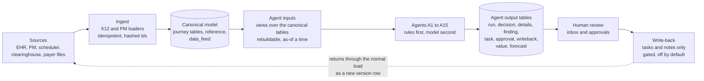

# KrisnnAI RCM: architecture and how to inspect it

Synthetic data only, shadow mode, no real PHI. This page is the map. Detail lives in the files it points to.

## 1. The ecosystem we sit in

A US medical practice earns money through a long chain of hand-offs between systems that do not talk to each other well:

| Who | What they hold | Messages (X12) |
|---|---|---|
| Patient and front desk | Booking, insurance card, copay | |
| EHR (clinical) and PM (billing) | Visit, note, charges, claims, ledger | |
| Payer (insurer) | Coverage, rules, contracts, adjudication | 270/271 eligibility, 278 prior authorization |
| Clearinghouse | Formats and routes claims | 837 claim, 999/277CA acknowledgement, 276/277 status |
| Payer to practice | The money and the explanation | 835 remittance, EFT |
| Patient (again) | Balance after insurance | Statements |

Money leaks at every hand-off: coverage lapsed at booking, authorization missing, note unsigned so charges are late, a code that does not match the documentation, a claim the payer's rules will reject, a denial nobody works before the appeal window closes, a payment below the contract rate, cash that was paid but never posted, an old balance nobody chases. Each leak is small. Together they are a large share of revenue, and the tools that could find them are built for single steps.

## 2. Our agentic take

KrisnnAI is an **intelligence layer above the PM/EHR and clearinghouse**. It does not replace them.

- **It reads, ranks and prepares; people decide.** Read-only toward client systems. Codes, refunds and write-offs never change without a named human approval. Claims go to payers only through the partner clearinghouse.
- **Fifteen narrow agents**, one per leak, each watching one stage of the journey and raising findings and tasks (section 4).
- **Rules first, AI second.** Deadlines, contract math, required fields and duplicates are plain code. A model is used only for extraction, classification, prediction or drafting, behind one abstraction.
- **Every action leaves a decision record**: which rule fired, what data was seen (and when it was known), the model and prompt hash if any, the autonomy level, who approved. No record, no action.
- **Autonomy is earned.** L0 observe, L1 assist, L2 prepare, L3 approve-and-run, L4 bounded autonomous. Every new action type starts at L0 in **shadow mode**: it records what it would have done and sends nothing.
- **Point-in-time truth.** Everything can be replayed "as of" a moment using only what was known then, so an agent's accuracy can be measured honestly.
- **Tenant isolation and no raw identifiers.** Every table has `tenant_id`. Patient and member numbers exist only as salted hashes.

The full rules are in `CLAUDE.md`. The plan and status are in `docs/BUILD_PLAN.md` and `docs/ROADMAP.md`.

## 3. How the pieces fit

Two rules keep this honest: agents **never write into the canonical tables**, and anything an agent concludes is stored as its own output, never mixed with source data.

## 4. The fifteen agents

All fifteen are built in shadow mode (see `docs/ROADMAP.md` for what each still needs).

| Stage | Agent | Name | What it watches |
|---|---|---|---|
| Before the visit | A1 | Gatekeeper | Eligibility and coverage (270/271), patient estimate |
| | A2 | Permit Clerk | Prior authorization and referrals |
| After the visit | A3 | Note Chaser | Documentation and charge completeness |
| | A4 | Code Whisperer | Coding and charge integrity (suggestions only) |
| Before the claim leaves | A5 | Mirror | Claim prevention and the denial "digital twin" |
| Submission | A6 | Courier | Claim submission, acknowledgements, rejections |
| After submission | A7 | Hunter | Accounts-receivable follow-up and claim status |
| Denials | A8 | Advocate | Denial resolution and appeals |
| | A9 | Coach | Learns denial patterns and proposes prevention rules |
| Payment | A10 | Auditor | Underpayment against the contract |
| | A11 | Bookkeeper | Payment posting and reconciliation (835 against what was posted) |
| Patient balance | A12 | Concierge | Patient statements and payment follow-up (staff worklist) |
| Across the practice | A13 | Credentialing | Provider enrollment and screening |
| | A14 | Captain | Control tower: cross-agent inbox, cash forecast, signals |
| | A15 | Detective / Scout | Revenue assurance: realisation against contract by payer and code |

## 5. The database design in one page

The **canonical model** is source-neutral: any EHR, PM, scheduler or clearinghouse feeds the same tables, and what a source cannot supply uses a documented fallback and is flagged. Full detail: `docs/data_model/`.

- **Four journey stages, each a header plus a detail table:** appointment, encounter, bill and claim, then money (transactions, denials, AR). A **bill** is the practice's own charge; a **claim** is a request to one payer, so one bill can have several claims.
- **Money is a signed, append-only ledger** (`transactions`). A mistake is a new reversing row. Denials and AR hang off it.
- **Two ids in every table:** `<table>_id` (internal, used for every join) and `<table>_number` (the client's own number, in a restricted column, never shown in reports).
- **Nothing is overwritten.** A change closes the old row (`is_current`, `replaced_date`) and adds a new version linked by `previous_<table>_id`.
- **Priorities and fallbacks.** Every table and column is Mandatory, Important or Optional, and has a stated fallback if the source does not send it. The `data_feed` table records which fallback each client table runs on, so a missing feed shows as "unavailable", not zero.
- **Agent outputs are their own tables** (`agent_run`, `agent_decision` and details, `agent_finding`, `agent_task`, `agent_approval`, `agent_writeback`, `agent_value`, `agent_forecast`).
- **Every row carries** `tenant_id`, `source`, `is_reconstructed`, `known_at`, `loaded_at`. Money is `DECIMAL(12,2)`.

**Where the code stands today:** the application code and Alembic migrations still target the earlier design. The canonical model is the design target and is not wired into them yet. The local database below holds the **schema only** (no rows), so you can inspect the design now.

## 6. Inspect it yourself in VS Code

Open the folder `KrisnnAI_Agentic_RCM` in VS Code. It will offer the recommended extensions (Claude Code, Python, Ruff, MSSQL, Mermaid preview, Docker, Excel viewer).

| I want to see | Do this |
|---|---|
| The tables and how they link | Open `docs/data_model/ER-diagrams.md`, then the Markdown preview (Ctrl+Shift+V). One diagram per stage. |
| A readable list of every table | `docs/data_model/TABLE-CATALOG.md` |
| Every column, why it exists, its fallback | Run task **Data dictionary: open in browser** (searchable; filter "New in review" for recent additions) or open `docs/data_model/KrisnnAI-Canonical-Data-Model.xlsx` |
| The real database | Run task **Database: start and load the canonical schema** (Terminal, Run Task). Then in the MSSQL panel connect to **KrisnnAI canonical model (local)**. The password is in `.env.db`, which is git-ignored. |
| Ready-made questions to ask the database | Open `docs/data_model/inspect-queries.sql`, connect, and run a block |
| Which agent field lands where | `docs/data_model/KrisnnAI-Agent-Field-Remap.xlsx`, sheets `Remapped` and `By final table` |
| The decisions behind it | `docs/data_model/agent-field-review-decisions.md` and `tools/data_model/plan/notes_*.md` |
| What the code is doing as I change it | Claude Code extension: edits appear as diffs in the editor for you to accept or reject. In a terminal session, `/ide` connects the CLI to this VS Code window. |

Everything generated can be rebuilt with the task **Data model: rebuild ...** (`python tools/data_model/build_all.py`). To change the model, edit `tools/data_model/gen_final.py` or a `plan/` module, rebuild, and review the diff in `docs/data_model/`.
