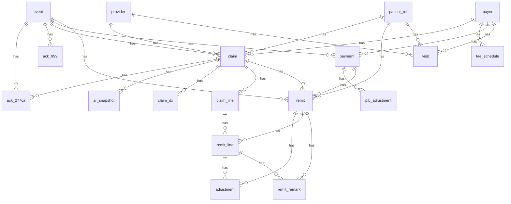

# KrisnAI core data model (M1)

> Generated from `krisnai/model` by `python -m krisnai.model.docgen`. Do not edit by hand;
> a test fails when this file is out of date.

## Principles

- **Event sourced.** `event` rows are append-only (a SQL Server trigger rejects UPDATE and DELETE).
  Normalized tables are rebuilt from events.
- **Tenant isolation.** Every table has `tenant_id`. Every child references its parent with a
  composite `(tenant_id, parent_id)` foreign key, so a row can never point at another tenant's
  parent. Application code reads and writes through `tenant_session`, which filters every
  SELECT by tenant and stamps every INSERT.
- **Idempotency.** Unique keys marked below make re-ingesting a file (same SHA-256) or a
  transaction (same ISA13/GS06/ST02) a no-op instead of a duplicate.
- **No raw PHI columns.** Patients exist only as `patient_ref.ref_hash`, a salted SHA-256.
- **Money is DECIMAL(18,2), units DECIMAL(9,2), dates are DATE.**
- Match links (`remit.claim_id`, `remit_line.claim_line_id`, `ack_277ca.claim_id`) stay NULL until
  M3 fills them in and records `match_method`.

## Relationships

`tenant` owns every table (omitted from the diagram).

## Tables

### `tenant`

| Column | Type | Null | Source |
|---|---|---|---|
| `tenant_id` | BIGINT | no | surrogate key (IDENTITY); the tenant id used everywhere |
| `name` | VARCHAR(200) | no | client-provided practice name |
| `patient_salt_key` | VARCHAR(100) | no | name of the env/secret-store key holding this tenant's patient-hash salt |
| `created_at` | DATETIME2(0) | no | server UTC time the tenant was created |

### `source_file`

Unique keys (idempotency): `(tenant_id, file_sha256)`

| Column | Type | Null | Source |
|---|---|---|---|
| `id` | BIGINT | no | surrogate key (IDENTITY) |
| `tenant_id` | BIGINT | no | owning tenant; every query filters on it |
| `file_name` | VARCHAR(500) | no | file name as received (no PHI in names) |
| `file_sha256` | CHAR(64) | no | SHA-256 of the file bytes |
| `file_type` | VARCHAR(20) | no | 837P | 835 | 999 | 277CA | fee_schedule | visits | ar_snapshot |
| `byte_size` | BIGINT | no | file size in bytes |
| `status` | VARCHAR(20) | no | loaded | failed |
| `failure_reason` | VARCHAR(1000) | yes | parser error text when status = failed |
| `loaded_at` | DATETIME2(0) | no | server UTC time the row was loaded |

### `event`

Unique keys (idempotency): `(tenant_id, source_file_id, isa13, gs06, st02, seq_in_file)`

| Column | Type | Null | Source |
|---|---|---|---|
| `id` | BIGINT | no | surrogate key (IDENTITY) |
| `tenant_id` | BIGINT | no | owning tenant; every query filters on it |
| `source_file_id` | BIGINT | no | file this row was loaded from (lineage) |
| `event_type` | VARCHAR(40) | no | 837P.claim | 835.remit | 999.ack | 277CA.claim_status | ... |
| `isa13` | VARCHAR(9) | no | ISA13 interchange control number |
| `gs06` | VARCHAR(9) | no | GS06 group control number |
| `st02` | VARCHAR(9) | no | ST02 transaction set control number |
| `seq_in_file` | INTEGER | no | position of this event within its transaction set |
| `known_at` | DATETIME2(0) | no | when the data became known (point-in-time key) |
| `payload` | NVARCHAR(MAX) | no | the parsed record as JSON; patient identifiers are already hashed, so no PHI |
| `loaded_at` | DATETIME2(0) | no | server UTC time the row was loaded |

### `patient_ref`

Unique keys (idempotency): `(tenant_id, ref_hash)`

| Column | Type | Null | Source |
|---|---|---|---|
| `id` | BIGINT | no | surrogate key (IDENTITY) |
| `tenant_id` | BIGINT | no | owning tenant; every query filters on it |
| `source_file_id` | BIGINT | no | file this row was loaded from (lineage) |
| `ref_hash` | IMAGE | no | SHA-256(tenant salt + NM109 member id), computed before the row is written |
| `loaded_at` | DATETIME2(0) | no | server UTC time the row was loaded |

### `payer`

Unique keys (idempotency): `(tenant_id, payer_id_code)`

| Column | Type | Null | Source |
|---|---|---|---|
| `id` | BIGINT | no | surrogate key (IDENTITY) |
| `tenant_id` | BIGINT | no | owning tenant; every query filters on it |
| `source_file_id` | BIGINT | no | file this row was loaded from (lineage) |
| `payer_id_code` | VARCHAR(80) | no | NM109 where NM101 = PR/PI (payer identifier) |
| `name` | VARCHAR(200) | no | NM103 payer name |
| `loaded_at` | DATETIME2(0) | no | server UTC time the row was loaded |

### `provider`

Unique keys (idempotency): `(tenant_id, npi)`

| Column | Type | Null | Source |
|---|---|---|---|
| `id` | BIGINT | no | surrogate key (IDENTITY) |
| `tenant_id` | BIGINT | no | owning tenant; every query filters on it |
| `source_file_id` | BIGINT | no | file this row was loaded from (lineage) |
| `npi` | VARCHAR(10) | no | NM109 where NM108 = XX (billing / pay-to NPI) |
| `name` | VARCHAR(200) | no | NM103 organization or provider name |
| `tax_id` | VARCHAR(9) | yes | REF*EI (employer identification number) |
| `loaded_at` | DATETIME2(0) | no | server UTC time the row was loaded |

### `ack_999`

Unique keys (idempotency): `(tenant_id, event_id)`

| Column | Type | Null | Source |
|---|---|---|---|
| `id` | BIGINT | no | surrogate key (IDENTITY) |
| `tenant_id` | BIGINT | no | owning tenant; every query filters on it |
| `source_file_id` | BIGINT | no | file this row was loaded from (lineage) |
| `event_id` | BIGINT | no | event this row was built from |
| `acked_gs06` | VARCHAR(9) | no | AK1-02 group control number being acknowledged |
| `acked_st02` | VARCHAR(9) | no | AK2-02 transaction set control number acknowledged |
| `transaction_set` | VARCHAR(3) | no | AK2-01 (837) |
| `transaction_status` | VARCHAR(1) | no | IK5-01 (A accepted, E accepted with errors, R rejected) |
| `group_status` | VARCHAR(1) | yes | AK9-01 |
| `error_codes` | VARCHAR(100) | yes | IK5-02..06 / IK4-03 joined with commas |
| `loaded_at` | DATETIME2(0) | no | server UTC time the row was loaded |

### `claim`

Unique keys (idempotency): `(tenant_id, event_id)`

| Column | Type | Null | Source |
|---|---|---|---|
| `id` | BIGINT | no | surrogate key (IDENTITY) |
| `tenant_id` | BIGINT | no | owning tenant; every query filters on it |
| `source_file_id` | BIGINT | no | file this row was loaded from (lineage) |
| `event_id` | BIGINT | no | event this row was built from |
| `payer_id` | BIGINT | no | NM1*PR loop 2010BB, resolved to payer.id |
| `provider_id` | BIGINT | no | NM1*85 loop 2010AA, resolved to provider.id |
| `patient_ref_id` | BIGINT | no | NM1*IL loop 2010BA member id, hashed to patient_ref.id |
| `claim_submitter_id` | VARCHAR(38) | no | CLM01 patient control number |
| `total_charge` | NUMERIC(18, 2) | no | CLM02 total claim charge |
| `place_of_service` | VARCHAR(2) | yes | CLM05-1 facility code |
| `frequency_code` | VARCHAR(1) | no | CLM05-3 (1 original, 7 replacement, 8 void) |
| `payer_claim_control_number` | VARCHAR(50) | yes | REF*F8 original reference number |
| `service_date` | DATE | yes | DTP*472 / DTP*434 earliest service date |
| `submitted_on` | DATE | yes | BHT04 transaction creation date |
| `loaded_at` | DATETIME2(0) | no | server UTC time the row was loaded |

### `fee_schedule`

Unique keys (idempotency): `(tenant_id, payer_id, cpt, modifier, effective_date)`

| Column | Type | Null | Source |
|---|---|---|---|
| `id` | BIGINT | no | surrogate key (IDENTITY) |
| `tenant_id` | BIGINT | no | owning tenant; every query filters on it |
| `source_file_id` | BIGINT | no | file this row was loaded from (lineage) |
| `payer_id` | BIGINT | no | fee schedule CSV payer_id, resolved to payer.id |
| `cpt` | VARCHAR(5) | no | fee schedule CSV cpt (matches SV1-01-2 / SVC01-2) |
| `modifier` | VARCHAR(2) | no | fee schedule CSV modifier, empty string when none |
| `allowed_amount` | NUMERIC(18, 2) | no | fee schedule CSV allowed_amount |
| `effective_date` | DATE | no | fee schedule CSV effective_date |
| `end_date` | DATE | yes | fee schedule CSV end_date, null = open ended |
| `loaded_at` | DATETIME2(0) | no | server UTC time the row was loaded |

### `payment`

Unique keys (idempotency): `(tenant_id, event_id)`

| Column | Type | Null | Source |
|---|---|---|---|
| `id` | BIGINT | no | surrogate key (IDENTITY) |
| `tenant_id` | BIGINT | no | owning tenant; every query filters on it |
| `source_file_id` | BIGINT | no | file this row was loaded from (lineage) |
| `event_id` | BIGINT | no | event this row was built from |
| `payer_id` | BIGINT | no | N1*PR loop 1000A, resolved to payer.id |
| `trace_number` | VARCHAR(50) | no | TRN02 reassociation trace number |
| `payment_amount` | NUMERIC(18, 2) | no | BPR02 total actual provider payment |
| `credit_debit` | VARCHAR(1) | no | BPR03 (C credit, D debit) |
| `payment_method` | VARCHAR(3) | no | BPR04 (ACH, CHK, NON) |
| `payment_date` | DATE | no | BPR16 check issue / EFT effective date |
| `loaded_at` | DATETIME2(0) | no | server UTC time the row was loaded |

### `visit`

Unique keys (idempotency): `(tenant_id, visit_ref)`

| Column | Type | Null | Source |
|---|---|---|---|
| `id` | BIGINT | no | surrogate key (IDENTITY) |
| `tenant_id` | BIGINT | no | owning tenant; every query filters on it |
| `source_file_id` | BIGINT | no | file this row was loaded from (lineage) |
| `visit_ref` | VARCHAR(40) | no | visits CSV visit_id (the PM system's own visit number) |
| `payer_id` | BIGINT | no | visits CSV payer_id, resolved to payer.id |
| `provider_id` | BIGINT | no | visits CSV provider_npi, resolved to provider.id |
| `patient_ref_id` | BIGINT | no | visits CSV patient_ref (member id), hashed to patient_ref.id |
| `service_date` | DATE | no | visits CSV dos |
| `cpt` | VARCHAR(5) | no | visits CSV cpt |
| `units` | NUMERIC(9, 2) | no | visits CSV units |
| `loaded_at` | DATETIME2(0) | no | server UTC time the row was loaded |

### `ack_277ca`

Unique keys (idempotency): `(tenant_id, event_id, claim_submitter_id)`

| Column | Type | Null | Source |
|---|---|---|---|
| `id` | BIGINT | no | surrogate key (IDENTITY) |
| `tenant_id` | BIGINT | no | owning tenant; every query filters on it |
| `source_file_id` | BIGINT | no | file this row was loaded from (lineage) |
| `event_id` | BIGINT | no | event this row was built from |
| `claim_id` | BIGINT | yes | matched claim (set by matching, null until then) |
| `claim_submitter_id` | VARCHAR(38) | no | TRN02 (echo of CLM01) |
| `status_category` | VARCHAR(5) | no | STC01-1 (A1 received, A2 accepted, A3 returned, A4 not found) |
| `status_code` | VARCHAR(5) | yes | STC01-2 |
| `entity_code` | VARCHAR(5) | yes | STC01-3 |
| `status_date` | DATE | yes | STC02 |
| `total_charge` | NUMERIC(18, 2) | yes | STC04 |
| `payer_claim_number` | VARCHAR(50) | yes | REF*1K payer claim control number |
| `loaded_at` | DATETIME2(0) | no | server UTC time the row was loaded |

### `ar_snapshot`

Unique keys (idempotency): `(tenant_id, claim_id, as_of_date)`

| Column | Type | Null | Source |
|---|---|---|---|
| `id` | BIGINT | no | surrogate key (IDENTITY) |
| `tenant_id` | BIGINT | no | owning tenant; every query filters on it |
| `source_file_id` | BIGINT | no | file this row was loaded from (lineage) |
| `claim_id` | BIGINT | no | claim the balance belongs to |
| `as_of_date` | DATE | no | snapshot date; only data known by this date is used |
| `balance` | NUMERIC(18, 2) | no | claim charge less paid, adjusted and patient amounts as of the date |
| `days_outstanding` | INTEGER | no | as_of_date minus claim service date |
| `aging_bucket` | VARCHAR(10) | no | 0-30 | 31-60 | 61-90 | 91-120 | 120+ |
| `loaded_at` | DATETIME2(0) | no | server UTC time the row was loaded |

### `claim_dx`

Unique keys (idempotency): `(tenant_id, claim_id, seq)`

| Column | Type | Null | Source |
|---|---|---|---|
| `id` | BIGINT | no | surrogate key (IDENTITY) |
| `tenant_id` | BIGINT | no | owning tenant; every query filters on it |
| `source_file_id` | BIGINT | no | file this row was loaded from (lineage) |
| `claim_id` | BIGINT | no | parent claim |
| `seq` | INTEGER | no | position within HI (1 = principal) |
| `dx_qualifier` | VARCHAR(3) | no | HI01-1 (ABK principal, ABF other) |
| `dx_code` | VARCHAR(8) | no | HI01-2 ICD-10-CM code, no decimal point |
| `loaded_at` | DATETIME2(0) | no | server UTC time the row was loaded |

### `claim_line`

Unique keys (idempotency): `(tenant_id, claim_id, line_number)`

| Column | Type | Null | Source |
|---|---|---|---|
| `id` | BIGINT | no | surrogate key (IDENTITY) |
| `tenant_id` | BIGINT | no | owning tenant; every query filters on it |
| `source_file_id` | BIGINT | no | file this row was loaded from (lineage) |
| `claim_id` | BIGINT | no | parent claim |
| `line_number` | INTEGER | no | LX01 assigned number |
| `cpt` | VARCHAR(5) | no | SV101-2 procedure code |
| `modifier_1` | VARCHAR(2) | yes | SV101-3 |
| `modifier_2` | VARCHAR(2) | yes | SV101-4 |
| `modifier_3` | VARCHAR(2) | yes | SV101-5 |
| `modifier_4` | VARCHAR(2) | yes | SV101-6 |
| `charge` | NUMERIC(18, 2) | no | SV102 line charge |
| `units` | NUMERIC(9, 2) | no | SV104 service unit count |
| `unit_basis` | VARCHAR(2) | no | SV103 (UN units, MJ minutes) |
| `diagnosis_pointer` | VARCHAR(8) | yes | SV107 diagnosis code pointer |
| `service_date` | DATE | yes | DTP*472 line service date |
| `loaded_at` | DATETIME2(0) | no | server UTC time the row was loaded |

### `plb_adjustment`

Unique keys (idempotency): `(tenant_id, payment_id, seq)`

| Column | Type | Null | Source |
|---|---|---|---|
| `id` | BIGINT | no | surrogate key (IDENTITY) |
| `tenant_id` | BIGINT | no | owning tenant; every query filters on it |
| `source_file_id` | BIGINT | no | file this row was loaded from (lineage) |
| `payment_id` | BIGINT | no | payment this PLB belongs to |
| `seq` | INTEGER | no | position of the reason/amount pair within the PLB |
| `provider_ref` | VARCHAR(50) | no | PLB01 provider identifier |
| `fiscal_period_date` | DATE | no | PLB02 |
| `reason_code` | VARCHAR(2) | no | PLB03-1 adjustment reason (WO, 72, L6, ...) |
| `reference_id` | VARCHAR(50) | yes | PLB03-2 reference identification |
| `amount` | NUMERIC(18, 2) | no | PLB04 adjustment amount (sign as sent) |
| `loaded_at` | DATETIME2(0) | no | server UTC time the row was loaded |

### `remit`

Unique keys (idempotency): `(tenant_id, event_id)`

| Column | Type | Null | Source |
|---|---|---|---|
| `id` | BIGINT | no | surrogate key (IDENTITY) |
| `tenant_id` | BIGINT | no | owning tenant; every query filters on it |
| `source_file_id` | BIGINT | no | file this row was loaded from (lineage) |
| `event_id` | BIGINT | no | event this row was built from |
| `payment_id` | BIGINT | no | payment (BPR/TRN) this CLP belongs to |
| `claim_id` | BIGINT | yes | matched claim (set by M3 matching, null until then) |
| `patient_ref_id` | BIGINT | yes | NM1*QC member id, hashed to patient_ref.id |
| `claim_submitter_id` | VARCHAR(38) | no | CLP01 patient control number (= CLM01) |
| `claim_status_code` | VARCHAR(2) | no | CLP02 (1 processed primary, 4 denied, 22 reversal) |
| `total_charge` | NUMERIC(18, 2) | no | CLP03 total claim charge |
| `total_paid` | NUMERIC(18, 2) | no | CLP04 claim payment amount |
| `patient_responsibility` | NUMERIC(18, 2) | no | CLP05 patient responsibility amount |
| `filing_indicator` | VARCHAR(2) | yes | CLP06 claim filing indicator code |
| `payer_claim_control_number` | VARCHAR(50) | no | CLP07 payer claim control number |
| `service_date` | DATE | yes | DTM*232 claim statement period start |
| `match_method` | VARCHAR(30) | yes | rule that linked this remit to a claim (M3) |
| `loaded_at` | DATETIME2(0) | no | server UTC time the row was loaded |

### `remit_line`

Unique keys (idempotency): `(tenant_id, remit_id, line_number)`

| Column | Type | Null | Source |
|---|---|---|---|
| `id` | BIGINT | no | surrogate key (IDENTITY) |
| `tenant_id` | BIGINT | no | owning tenant; every query filters on it |
| `source_file_id` | BIGINT | no | file this row was loaded from (lineage) |
| `remit_id` | BIGINT | no | parent remit |
| `claim_line_id` | BIGINT | yes | matched claim line (set by M3 matching) |
| `line_number` | INTEGER | no | position of the SVC within the CLP loop |
| `cpt` | VARCHAR(5) | no | SVC01-2 adjudicated procedure code |
| `modifier_1` | VARCHAR(2) | yes | SVC01-3 |
| `modifier_2` | VARCHAR(2) | yes | SVC01-4 |
| `modifier_3` | VARCHAR(2) | yes | SVC01-5 |
| `modifier_4` | VARCHAR(2) | yes | SVC01-6 |
| `charge` | NUMERIC(18, 2) | no | SVC02 line charge |
| `paid` | NUMERIC(18, 2) | no | SVC03 line payment |
| `units` | NUMERIC(9, 2) | yes | SVC05 units paid |
| `allowed_amount` | NUMERIC(18, 2) | yes | AMT*B6 allowed amount |
| `service_date` | DATE | yes | DTM*472 line service date |
| `match_method` | VARCHAR(30) | yes | rule that linked this line to a claim line (M3) |
| `loaded_at` | DATETIME2(0) | no | server UTC time the row was loaded |

### `adjustment`

Unique keys (idempotency): `(tenant_id, remit_id, remit_line_id, seq)`

| Column | Type | Null | Source |
|---|---|---|---|
| `id` | BIGINT | no | surrogate key (IDENTITY) |
| `tenant_id` | BIGINT | no | owning tenant; every query filters on it |
| `source_file_id` | BIGINT | no | file this row was loaded from (lineage) |
| `remit_id` | BIGINT | no | parent remit |
| `remit_line_id` | BIGINT | yes | parent remit line, null for claim-level CAS |
| `seq` | INTEGER | no | position of the pair within the remit / line |
| `group_code` | VARCHAR(2) | no | CAS01 (CO contractual, PR patient, OA other, PI payer initiated, CR correction) |
| `reason_code` | VARCHAR(5) | no | CAS02/05/08/... CARC |
| `amount` | NUMERIC(18, 2) | no | CAS03/06/09/... adjustment amount |
| `quantity` | NUMERIC(9, 2) | yes | CAS04/07/10/... adjustment quantity |
| `loaded_at` | DATETIME2(0) | no | server UTC time the row was loaded |

### `remit_remark`

Unique keys (idempotency): `(tenant_id, remit_id, remit_line_id, remark_code)`

| Column | Type | Null | Source |
|---|---|---|---|
| `id` | BIGINT | no | surrogate key (IDENTITY) |
| `tenant_id` | BIGINT | no | owning tenant; every query filters on it |
| `source_file_id` | BIGINT | no | file this row was loaded from (lineage) |
| `remit_id` | BIGINT | no | parent remit |
| `remit_line_id` | BIGINT | yes | parent remit line, null for claim-level remark |
| `code_qualifier` | VARCHAR(2) | no | LQ01 (HE healthcare remark codes) |
| `remark_code` | VARCHAR(10) | no | LQ02 RARC |
| `loaded_at` | DATETIME2(0) | no | server UTC time the row was loaded |
