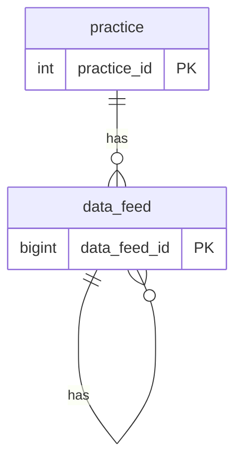

# Entity-relationship diagrams

GENERATED by `tools/data_model/build_sql.py`. Open this file in VS Code and use the Markdown preview (Mermaid extension) or view it on GitHub.
Lines are the links between tables (child on the many side). Only links between tables are drawn; each table has more columns than shown (see the data dictionary).

## Whole model (links only)

```mermaid
erDiagram
    adjustment_reason {
        int adjustment_reason_id PK
    }
    agent_approval {
        bigint agent_approval_id PK
    }
    agent_decision {
        bigint agent_decision_id PK
    }
    agent_decision_details {
        bigint agent_decision_detail_id PK
    }
    agent_finding {
        bigint agent_finding_id PK
    }
    agent_forecast {
        bigint agent_forecast_id PK
    }
    agent_run {
        bigint agent_run_id PK
    }
    agent_task {
        bigint agent_task_id PK
    }
    agent_value {
        bigint agent_value_id PK
    }
    agent_writeback {
        bigint agent_writeback_id PK
    }
    appeal {
        bigint appeal_id PK
    }
    appointment {
        bigint appointment_id PK
    }
    appointment_details {
        bigint appointment_detail_id PK
    }
    appointment_slot {
        bigint appointment_slot_id PK
    }
    ar {
        bigint ar_id PK
    }
    ar_interval {
        bigint ar_interval_id PK
    }
    authorization {
        bigint authorization_id PK
    }
    bill {
        bigint bill_id PK
    }
    bill_details {
        bigint bill_detail_id PK
    }
    calendar {
        bigint calendar_id PK
    }
    claim {
        bigint claim_id PK
    }
    claim_attachment {
        bigint claim_attachment_id PK
    }
    claim_details {
        bigint claim_detail_id PK
    }
    claim_status_history {
        bigint claim_status_history_id PK
    }
    contract_rate {
        bigint contract_rate_id PK
    }
    coverage {
        bigint coverage_id PK
    }
    cpt_code {
        int cpt_code_id PK
    }
    data_feed {
        bigint data_feed_id PK
    }
    denial {
        bigint denial_id PK
    }
    denial_details {
        bigint denial_detail_id PK
    }
    diagnosis_code {
        int diagnosis_code_id PK
    }
    document {
        bigint document_id PK
    }
    eligibility_check {
        bigint eligibility_check_id PK
    }
    encounter {
        bigint encounter_id PK
    }
    encounter_details {
        bigint encounter_detail_id PK
    }
    enrollment {
        bigint enrollment_id PK
    }
    facility {
        int facility_id PK
    }
    fee_list {
        int fee_list_id PK
    }
    modifier {
        int modifier_id PK
    }
    order {
        bigint order_id PK
    }
    patient {
        bigint patient_id PK
    }
    patient_contact_preference {
        bigint patient_contact_preference_id PK
    }
    patient_statement {
        bigint patient_statement_id PK
    }
    payer {
        int payer_id PK
    }
    payer_rule {
        bigint payer_rule_id PK
    }
    payment {
        bigint payment_id PK
    }
    payment_adjustment {
        bigint payment_adjustment_id PK
    }
    payment_plan {
        bigint payment_plan_id PK
    }
    place_of_service {
        int place_of_service_id PK
    }
    practice {
        int practice_id PK
    }
    practice_settings {
        bigint practice_settings_id PK
    }
    provider {
        int provider_id PK
    }
    referral {
        bigint referral_id PK
    }
    remark_code {
        int remark_code_id PK
    }
    specialty {
        int specialty_id PK
    }
    staff {
        bigint staff_id PK
    }
    transactions {
        bigint transaction_id PK
    }
    agent_decision ||--o{ agent_approval : has
    agent_task ||--o{ agent_approval : has
    practice ||--o{ agent_approval : has
    staff ||--o{ agent_approval : has
    agent_decision ||--o{ agent_decision : has
    agent_finding ||--o{ agent_decision : has
    agent_run ||--o{ agent_decision : has
    agent_task ||--o{ agent_decision : has
    appointment ||--o{ agent_decision : has
    authorization ||--o{ agent_decision : has
    bill ||--o{ agent_decision : has
    claim ||--o{ agent_decision : has
    denial ||--o{ agent_decision : has
    encounter ||--o{ agent_decision : has
    patient ||--o{ agent_decision : has
    payer ||--o{ agent_decision : has
    practice ||--o{ agent_decision : has
    provider ||--o{ agent_decision : has
    specialty ||--o{ agent_decision : has
    agent_decision ||--o{ agent_decision_details : has
    cpt_code ||--o{ agent_decision_details : has
    payer ||--o{ agent_decision_details : has
    payer_rule ||--o{ agent_decision_details : has
    practice ||--o{ agent_decision_details : has
    agent_decision ||--o{ agent_finding : has
    agent_finding ||--o{ agent_finding : has
    agent_run ||--o{ agent_finding : has
    appointment ||--o{ agent_finding : has
    authorization ||--o{ agent_finding : has
    bill ||--o{ agent_finding : has
    claim ||--o{ agent_finding : has
    denial ||--o{ agent_finding : has
    encounter ||--o{ agent_finding : has
    patient ||--o{ agent_finding : has
    payer ||--o{ agent_finding : has
    practice ||--o{ agent_finding : has
    provider ||--o{ agent_finding : has
    specialty ||--o{ agent_finding : has
    agent_forecast ||--o{ agent_forecast : has
    payer ||--o{ agent_forecast : has
    practice ||--o{ agent_forecast : has
    agent_run ||--o{ agent_run : has
    practice ||--o{ agent_run : has
    agent_decision ||--o{ agent_task : has
    agent_finding ||--o{ agent_task : has
    agent_task ||--o{ agent_task : has
    appointment ||--o{ agent_task : has
    authorization ||--o{ agent_task : has
    bill ||--o{ agent_task : has
    claim ||--o{ agent_task : has
    denial ||--o{ agent_task : has
    encounter ||--o{ agent_task : has
    patient ||--o{ agent_task : has
    payer ||--o{ agent_task : has
    practice ||--o{ agent_task : has
    provider ||--o{ agent_task : has
    specialty ||--o{ agent_task : has
    staff ||--o{ agent_task : has
    agent_decision ||--o{ agent_value : has
    agent_finding ||--o{ agent_value : has
    claim ||--o{ agent_value : has
    cpt_code ||--o{ agent_value : has
    denial ||--o{ agent_value : has
    payer ||--o{ agent_value : has
    practice ||--o{ agent_value : has
    provider ||--o{ agent_value : has
    specialty ||--o{ agent_value : has
    transactions ||--o{ agent_value : has
    agent_approval ||--o{ agent_writeback : has
    agent_decision ||--o{ agent_writeback : has
    agent_writeback ||--o{ agent_writeback : has
    appointment ||--o{ agent_writeback : has
    claim ||--o{ agent_writeback : has
    practice ||--o{ agent_writeback : has
    agent_approval ||--o{ appeal : has
    agent_decision ||--o{ appeal : has
    appeal ||--o{ appeal : has
    claim ||--o{ appeal : has
    denial ||--o{ appeal : has
    patient ||--o{ appeal : has
    payer ||--o{ appeal : has
    practice ||--o{ appeal : has
    appointment ||--o{ appointment : has
    coverage ||--o{ appointment : has
    facility ||--o{ appointment : has
    patient ||--o{ appointment : has
    payer ||--o{ appointment : has
    practice ||--o{ appointment : has
    provider ||--o{ appointment : has
    referral ||--o{ appointment : has
    specialty ||--o{ appointment : has
    appointment ||--o{ appointment_details : has
    authorization ||--o{ appointment_details : has
    cpt_code ||--o{ appointment_details : has
    diagnosis_code ||--o{ appointment_details : has
    patient ||--o{ appointment_details : has
    payer ||--o{ appointment_details : has
    practice ||--o{ appointment_details : has
    provider ||--o{ appointment_details : has
    specialty ||--o{ appointment_details : has
    appointment ||--o{ appointment_slot : has
    appointment_slot ||--o{ appointment_slot : has
    facility ||--o{ appointment_slot : has
    practice ||--o{ appointment_slot : has
    provider ||--o{ appointment_slot : has
    specialty ||--o{ appointment_slot : has
    bill ||--o{ ar : has
    claim ||--o{ ar : has
    cpt_code ||--o{ ar : has
    facility ||--o{ ar : has
    patient ||--o{ ar : has
    payer ||--o{ ar : has
    practice ||--o{ ar : has
    provider ||--o{ ar : has
    specialty ||--o{ ar : has
    ar_interval ||--o{ ar_interval : has
    bill_details ||--o{ ar_interval : has
    claim ||--o{ ar_interval : has
    claim_details ||--o{ ar_interval : has
    cpt_code ||--o{ ar_interval : has
    facility ||--o{ ar_interval : has
    patient ||--o{ ar_interval : has
    payer ||--o{ ar_interval : has
    practice ||--o{ ar_interval : has
    provider ||--o{ ar_interval : has
    specialty ||--o{ ar_interval : has
    authorization ||--o{ authorization : has
    coverage ||--o{ authorization : has
    cpt_code ||--o{ authorization : has
    diagnosis_code ||--o{ authorization : has
    facility ||--o{ authorization : has
    patient ||--o{ authorization : has
    payer ||--o{ authorization : has
    place_of_service ||--o{ authorization : has
    practice ||--o{ authorization : has
    provider ||--o{ authorization : has
    bill ||--o{ bill : has
    coverage ||--o{ bill : has
    encounter ||--o{ bill : has
    facility ||--o{ bill : has
    patient ||--o{ bill : has
    payer ||--o{ bill : has
    place_of_service ||--o{ bill : has
    practice ||--o{ bill : has
    provider ||--o{ bill : has
    specialty ||--o{ bill : has
    authorization ||--o{ bill_details : has
    bill ||--o{ bill_details : has
    cpt_code ||--o{ bill_details : has
    diagnosis_code ||--o{ bill_details : has
    encounter_details ||--o{ bill_details : has
    fee_list ||--o{ bill_details : has
    modifier ||--o{ bill_details : has
    patient ||--o{ bill_details : has
    payer ||--o{ bill_details : has
    place_of_service ||--o{ bill_details : has
    practice ||--o{ bill_details : has
    provider ||--o{ bill_details : has
    specialty ||--o{ bill_details : has
    staff ||--o{ bill_details : has
    authorization ||--o{ claim : has
    bill ||--o{ claim : has
    claim ||--o{ claim : has
    coverage ||--o{ claim : has
    diagnosis_code ||--o{ claim : has
    encounter ||--o{ claim : has
    facility ||--o{ claim : has
    patient ||--o{ claim : has
    payer ||--o{ claim : has
    place_of_service ||--o{ claim : has
    practice ||--o{ claim : has
    provider ||--o{ claim : has
    specialty ||--o{ claim : has
    claim ||--o{ claim_attachment : has
    claim_attachment ||--o{ claim_attachment : has
    document ||--o{ claim_attachment : has
    patient ||--o{ claim_attachment : has
    payer ||--o{ claim_attachment : has
    practice ||--o{ claim_attachment : has
    adjustment_reason ||--o{ claim_details : has
    bill_details ||--o{ claim_details : has
    claim ||--o{ claim_details : has
    cpt_code ||--o{ claim_details : has
    diagnosis_code ||--o{ claim_details : has
    modifier ||--o{ claim_details : has
    patient ||--o{ claim_details : has
    payer ||--o{ claim_details : has
    practice ||--o{ claim_details : has
    provider ||--o{ claim_details : has
    specialty ||--o{ claim_details : has
    claim ||--o{ claim_status_history : has
    patient ||--o{ claim_status_history : has
    payer ||--o{ claim_status_history : has
    practice ||--o{ claim_status_history : has
    provider ||--o{ claim_status_history : has
    specialty ||--o{ claim_status_history : has
    cpt_code ||--o{ contract_rate : has
    modifier ||--o{ contract_rate : has
    payer ||--o{ contract_rate : has
    practice ||--o{ contract_rate : has
    provider ||--o{ contract_rate : has
    specialty ||--o{ contract_rate : has
    coverage ||--o{ coverage : has
    patient ||--o{ coverage : has
    payer ||--o{ coverage : has
    provider ||--o{ coverage : has
    data_feed ||--o{ data_feed : has
    practice ||--o{ data_feed : has
    adjustment_reason ||--o{ denial : has
    authorization ||--o{ denial : has
    bill_details ||--o{ denial : has
    claim ||--o{ denial : has
    claim_details ||--o{ denial : has
    cpt_code ||--o{ denial : has
    denial ||--o{ denial : has
    patient ||--o{ denial : has
    payer ||--o{ denial : has
    practice ||--o{ denial : has
    provider ||--o{ denial : has
    specialty ||--o{ denial : has
    transactions ||--o{ denial : has
    adjustment_reason ||--o{ denial_details : has
    claim_details ||--o{ denial_details : has
    cpt_code ||--o{ denial_details : has
    denial ||--o{ denial_details : has
    patient ||--o{ denial_details : has
    payer ||--o{ denial_details : has
    practice ||--o{ denial_details : has
    provider ||--o{ denial_details : has
    remark_code ||--o{ denial_details : has
    specialty ||--o{ denial_details : has
    authorization ||--o{ document : has
    claim ||--o{ document : has
    document ||--o{ document : has
    encounter ||--o{ document : has
    patient ||--o{ document : has
    practice ||--o{ document : has
    provider ||--o{ document : has
    appointment ||--o{ eligibility_check : has
    coverage ||--o{ eligibility_check : has
    patient ||--o{ eligibility_check : has
    payer ||--o{ eligibility_check : has
    practice ||--o{ eligibility_check : has
    appointment ||--o{ encounter : has
    authorization ||--o{ encounter : has
    coverage ||--o{ encounter : has
    diagnosis_code ||--o{ encounter : has
    encounter ||--o{ encounter : has
    facility ||--o{ encounter : has
    patient ||--o{ encounter : has
    payer ||--o{ encounter : has
    place_of_service ||--o{ encounter : has
    practice ||--o{ encounter : has
    provider ||--o{ encounter : has
    referral ||--o{ encounter : has
    specialty ||--o{ encounter : has
    authorization ||--o{ encounter_details : has
    cpt_code ||--o{ encounter_details : has
    diagnosis_code ||--o{ encounter_details : has
    encounter ||--o{ encounter_details : has
    modifier ||--o{ encounter_details : has
    patient ||--o{ encounter_details : has
    payer ||--o{ encounter_details : has
    place_of_service ||--o{ encounter_details : has
    practice ||--o{ encounter_details : has
    provider ||--o{ encounter_details : has
    specialty ||--o{ encounter_details : has
    facility ||--o{ enrollment : has
    payer ||--o{ enrollment : has
    practice ||--o{ enrollment : has
    provider ||--o{ enrollment : has
    place_of_service ||--o{ facility : has
    practice ||--o{ facility : has
    cpt_code ||--o{ fee_list : has
    facility ||--o{ fee_list : has
    modifier ||--o{ fee_list : has
    practice ||--o{ fee_list : has
    authorization ||--o{ order : has
    cpt_code ||--o{ order : has
    diagnosis_code ||--o{ order : has
    document ||--o{ order : has
    encounter ||--o{ order : has
    encounter_details ||--o{ order : has
    order ||--o{ order : has
    patient ||--o{ order : has
    practice ||--o{ order : has
    provider ||--o{ order : has
    coverage ||--o{ patient : has
    patient ||--o{ patient : has
    practice ||--o{ patient : has
    patient ||--o{ patient_contact_preference : has
    patient_contact_preference ||--o{ patient_contact_preference : has
    bill ||--o{ patient_statement : has
    claim ||--o{ patient_statement : has
    patient ||--o{ patient_statement : has
    patient_statement ||--o{ patient_statement : has
    payment_plan ||--o{ patient_statement : has
    practice ||--o{ patient_statement : has
    adjustment_reason ||--o{ payer_rule : has
    cpt_code ||--o{ payer_rule : has
    diagnosis_code ||--o{ payer_rule : has
    modifier ||--o{ payer_rule : has
    payer ||--o{ payer_rule : has
    payer_rule ||--o{ payer_rule : has
    place_of_service ||--o{ payer_rule : has
    practice ||--o{ payer_rule : has
    staff ||--o{ payer_rule : has
    payer ||--o{ payment : has
    payment ||--o{ payment : has
    practice ||--o{ payment : has
    provider ||--o{ payment : has
    payer ||--o{ payment_adjustment : has
    payment ||--o{ payment_adjustment : has
    practice ||--o{ payment_adjustment : has
    provider ||--o{ payment_adjustment : has
    patient ||--o{ payment_plan : has
    payment_plan ||--o{ payment_plan : has
    practice ||--o{ payment_plan : has
    practice ||--o{ practice_settings : has
    staff ||--o{ practice_settings : has
    practice ||--o{ provider : has
    provider ||--o{ provider : has
    specialty ||--o{ provider : has
    authorization ||--o{ referral : has
    coverage ||--o{ referral : has
    cpt_code ||--o{ referral : has
    diagnosis_code ||--o{ referral : has
    document ||--o{ referral : has
    patient ||--o{ referral : has
    payer ||--o{ referral : has
    practice ||--o{ referral : has
    provider ||--o{ referral : has
    referral ||--o{ referral : has
    specialty ||--o{ referral : has
    practice ||--o{ staff : has
    adjustment_reason ||--o{ transactions : has
    bill_details ||--o{ transactions : has
    claim ||--o{ transactions : has
    claim_details ||--o{ transactions : has
    cpt_code ||--o{ transactions : has
    denial ||--o{ transactions : has
    patient ||--o{ transactions : has
    payer ||--o{ transactions : has
    payment ||--o{ transactions : has
    practice ||--o{ transactions : has
    provider ||--o{ transactions : has
    remark_code ||--o{ transactions : has
    specialty ||--o{ transactions : has
    staff ||--o{ transactions : has
    transactions ||--o{ transactions : has
```

## 1 Appointment (5 tables, with the tables they link to)

```mermaid
erDiagram
    agent_decision {
        bigint agent_decision_id PK
    }
    agent_finding {
        bigint agent_finding_id PK
    }
    agent_task {
        bigint agent_task_id PK
    }
    agent_writeback {
        bigint agent_writeback_id PK
    }
    appointment {
        bigint appointment_id PK
    }
    appointment_details {
        bigint appointment_detail_id PK
    }
    appointment_slot {
        bigint appointment_slot_id PK
    }
    authorization {
        bigint authorization_id PK
    }
    coverage {
        bigint coverage_id PK
    }
    cpt_code {
        int cpt_code_id PK
    }
    diagnosis_code {
        int diagnosis_code_id PK
    }
    document {
        bigint document_id PK
    }
    eligibility_check {
        bigint eligibility_check_id PK
    }
    encounter {
        bigint encounter_id PK
    }
    facility {
        int facility_id PK
    }
    patient {
        bigint patient_id PK
    }
    payer {
        int payer_id PK
    }
    practice {
        int practice_id PK
    }
    provider {
        int provider_id PK
    }
    referral {
        bigint referral_id PK
    }
    specialty {
        int specialty_id PK
    }
    agent_decision ||--o{ agent_decision : has
    agent_finding ||--o{ agent_decision : has
    agent_task ||--o{ agent_decision : has
    appointment ||--o{ agent_decision : has
    authorization ||--o{ agent_decision : has
    encounter ||--o{ agent_decision : has
    patient ||--o{ agent_decision : has
    payer ||--o{ agent_decision : has
    practice ||--o{ agent_decision : has
    provider ||--o{ agent_decision : has
    specialty ||--o{ agent_decision : has
    agent_decision ||--o{ agent_finding : has
    agent_finding ||--o{ agent_finding : has
    appointment ||--o{ agent_finding : has
    authorization ||--o{ agent_finding : has
    encounter ||--o{ agent_finding : has
    patient ||--o{ agent_finding : has
    payer ||--o{ agent_finding : has
    practice ||--o{ agent_finding : has
    provider ||--o{ agent_finding : has
    specialty ||--o{ agent_finding : has
    agent_decision ||--o{ agent_task : has
    agent_finding ||--o{ agent_task : has
    agent_task ||--o{ agent_task : has
    appointment ||--o{ agent_task : has
    authorization ||--o{ agent_task : has
    encounter ||--o{ agent_task : has
    patient ||--o{ agent_task : has
    payer ||--o{ agent_task : has
    practice ||--o{ agent_task : has
    provider ||--o{ agent_task : has
    specialty ||--o{ agent_task : has
    agent_decision ||--o{ agent_writeback : has
    agent_writeback ||--o{ agent_writeback : has
    appointment ||--o{ agent_writeback : has
    practice ||--o{ agent_writeback : has
    appointment ||--o{ appointment : has
    coverage ||--o{ appointment : has
    facility ||--o{ appointment : has
    patient ||--o{ appointment : has
    payer ||--o{ appointment : has
    practice ||--o{ appointment : has
    provider ||--o{ appointment : has
    referral ||--o{ appointment : has
    specialty ||--o{ appointment : has
    appointment ||--o{ appointment_details : has
    authorization ||--o{ appointment_details : has
    cpt_code ||--o{ appointment_details : has
    diagnosis_code ||--o{ appointment_details : has
    patient ||--o{ appointment_details : has
    payer ||--o{ appointment_details : has
    practice ||--o{ appointment_details : has
    provider ||--o{ appointment_details : has
    specialty ||--o{ appointment_details : has
    appointment ||--o{ appointment_slot : has
    appointment_slot ||--o{ appointment_slot : has
    facility ||--o{ appointment_slot : has
    practice ||--o{ appointment_slot : has
    provider ||--o{ appointment_slot : has
    specialty ||--o{ appointment_slot : has
    authorization ||--o{ authorization : has
    coverage ||--o{ authorization : has
    cpt_code ||--o{ authorization : has
    diagnosis_code ||--o{ authorization : has
    facility ||--o{ authorization : has
    patient ||--o{ authorization : has
    payer ||--o{ authorization : has
    practice ||--o{ authorization : has
    provider ||--o{ authorization : has
    coverage ||--o{ coverage : has
    patient ||--o{ coverage : has
    payer ||--o{ coverage : has
    provider ||--o{ coverage : has
    authorization ||--o{ document : has
    document ||--o{ document : has
    encounter ||--o{ document : has
    patient ||--o{ document : has
    practice ||--o{ document : has
    provider ||--o{ document : has
    appointment ||--o{ eligibility_check : has
    coverage ||--o{ eligibility_check : has
    patient ||--o{ eligibility_check : has
    payer ||--o{ eligibility_check : has
    practice ||--o{ eligibility_check : has
    appointment ||--o{ encounter : has
    authorization ||--o{ encounter : has
    coverage ||--o{ encounter : has
    diagnosis_code ||--o{ encounter : has
    encounter ||--o{ encounter : has
    facility ||--o{ encounter : has
    patient ||--o{ encounter : has
    payer ||--o{ encounter : has
    practice ||--o{ encounter : has
    provider ||--o{ encounter : has
    referral ||--o{ encounter : has
    specialty ||--o{ encounter : has
    practice ||--o{ facility : has
    coverage ||--o{ patient : has
    patient ||--o{ patient : has
    practice ||--o{ patient : has
    practice ||--o{ provider : has
    provider ||--o{ provider : has
    specialty ||--o{ provider : has
    authorization ||--o{ referral : has
    coverage ||--o{ referral : has
    cpt_code ||--o{ referral : has
    diagnosis_code ||--o{ referral : has
    document ||--o{ referral : has
    patient ||--o{ referral : has
    payer ||--o{ referral : has
    practice ||--o{ referral : has
    provider ||--o{ referral : has
    referral ||--o{ referral : has
    specialty ||--o{ referral : has
```



## 2 Encounter (4 tables, with the tables they link to)

```mermaid
erDiagram
    agent_decision {
        bigint agent_decision_id PK
    }
    agent_finding {
        bigint agent_finding_id PK
    }
    agent_task {
        bigint agent_task_id PK
    }
    appointment {
        bigint appointment_id PK
    }
    authorization {
        bigint authorization_id PK
    }
    bill {
        bigint bill_id PK
    }
    bill_details {
        bigint bill_detail_id PK
    }
    claim {
        bigint claim_id PK
    }
    claim_attachment {
        bigint claim_attachment_id PK
    }
    coverage {
        bigint coverage_id PK
    }
    cpt_code {
        int cpt_code_id PK
    }
    diagnosis_code {
        int diagnosis_code_id PK
    }
    document {
        bigint document_id PK
    }
    encounter {
        bigint encounter_id PK
    }
    encounter_details {
        bigint encounter_detail_id PK
    }
    facility {
        int facility_id PK
    }
    modifier {
        int modifier_id PK
    }
    order {
        bigint order_id PK
    }
    patient {
        bigint patient_id PK
    }
    payer {
        int payer_id PK
    }
    place_of_service {
        int place_of_service_id PK
    }
    practice {
        int practice_id PK
    }
    provider {
        int provider_id PK
    }
    referral {
        bigint referral_id PK
    }
    specialty {
        int specialty_id PK
    }
    agent_decision ||--o{ agent_decision : has
    agent_finding ||--o{ agent_decision : has
    agent_task ||--o{ agent_decision : has
    appointment ||--o{ agent_decision : has
    authorization ||--o{ agent_decision : has
    bill ||--o{ agent_decision : has
    claim ||--o{ agent_decision : has
    encounter ||--o{ agent_decision : has
    patient ||--o{ agent_decision : has
    payer ||--o{ agent_decision : has
    practice ||--o{ agent_decision : has
    provider ||--o{ agent_decision : has
    specialty ||--o{ agent_decision : has
    agent_decision ||--o{ agent_finding : has
    agent_finding ||--o{ agent_finding : has
    appointment ||--o{ agent_finding : has
    authorization ||--o{ agent_finding : has
    bill ||--o{ agent_finding : has
    claim ||--o{ agent_finding : has
    encounter ||--o{ agent_finding : has
    patient ||--o{ agent_finding : has
    payer ||--o{ agent_finding : has
    practice ||--o{ agent_finding : has
    provider ||--o{ agent_finding : has
    specialty ||--o{ agent_finding : has
    agent_decision ||--o{ agent_task : has
    agent_finding ||--o{ agent_task : has
    agent_task ||--o{ agent_task : has
    appointment ||--o{ agent_task : has
    authorization ||--o{ agent_task : has
    bill ||--o{ agent_task : has
    claim ||--o{ agent_task : has
    encounter ||--o{ agent_task : has
    patient ||--o{ agent_task : has
    payer ||--o{ agent_task : has
    practice ||--o{ agent_task : has
    provider ||--o{ agent_task : has
    specialty ||--o{ agent_task : has
    appointment ||--o{ appointment : has
    coverage ||--o{ appointment : has
    facility ||--o{ appointment : has
    patient ||--o{ appointment : has
    payer ||--o{ appointment : has
    practice ||--o{ appointment : has
    provider ||--o{ appointment : has
    referral ||--o{ appointment : has
    specialty ||--o{ appointment : has
    authorization ||--o{ authorization : has
    coverage ||--o{ authorization : has
    cpt_code ||--o{ authorization : has
    diagnosis_code ||--o{ authorization : has
    facility ||--o{ authorization : has
    patient ||--o{ authorization : has
    payer ||--o{ authorization : has
    place_of_service ||--o{ authorization : has
    practice ||--o{ authorization : has
    provider ||--o{ authorization : has
    bill ||--o{ bill : has
    coverage ||--o{ bill : has
    encounter ||--o{ bill : has
    facility ||--o{ bill : has
    patient ||--o{ bill : has
    payer ||--o{ bill : has
    place_of_service ||--o{ bill : has
    practice ||--o{ bill : has
    provider ||--o{ bill : has
    specialty ||--o{ bill : has
    authorization ||--o{ bill_details : has
    bill ||--o{ bill_details : has
    cpt_code ||--o{ bill_details : has
    diagnosis_code ||--o{ bill_details : has
    encounter_details ||--o{ bill_details : has
    modifier ||--o{ bill_details : has
    patient ||--o{ bill_details : has
    payer ||--o{ bill_details : has
    place_of_service ||--o{ bill_details : has
    practice ||--o{ bill_details : has
    provider ||--o{ bill_details : has
    specialty ||--o{ bill_details : has
    authorization ||--o{ claim : has
    bill ||--o{ claim : has
    claim ||--o{ claim : has
    coverage ||--o{ claim : has
    diagnosis_code ||--o{ claim : has
    encounter ||--o{ claim : has
    facility ||--o{ claim : has
    patient ||--o{ claim : has
    payer ||--o{ claim : has
    place_of_service ||--o{ claim : has
    practice ||--o{ claim : has
    provider ||--o{ claim : has
    specialty ||--o{ claim : has
    claim ||--o{ claim_attachment : has
    claim_attachment ||--o{ claim_attachment : has
    document ||--o{ claim_attachment : has
    patient ||--o{ claim_attachment : has
    payer ||--o{ claim_attachment : has
    practice ||--o{ claim_attachment : has
    coverage ||--o{ coverage : has
    patient ||--o{ coverage : has
    payer ||--o{ coverage : has
    provider ||--o{ coverage : has
    authorization ||--o{ document : has
    claim ||--o{ document : has
    document ||--o{ document : has
    encounter ||--o{ document : has
    patient ||--o{ document : has
    practice ||--o{ document : has
    provider ||--o{ document : has
    appointment ||--o{ encounter : has
    authorization ||--o{ encounter : has
    coverage ||--o{ encounter : has
    diagnosis_code ||--o{ encounter : has
    encounter ||--o{ encounter : has
    facility ||--o{ encounter : has
    patient ||--o{ encounter : has
    payer ||--o{ encounter : has
    place_of_service ||--o{ encounter : has
    practice ||--o{ encounter : has
    provider ||--o{ encounter : has
    referral ||--o{ encounter : has
    specialty ||--o{ encounter : has
    authorization ||--o{ encounter_details : has
    cpt_code ||--o{ encounter_details : has
    diagnosis_code ||--o{ encounter_details : has
    encounter ||--o{ encounter_details : has
    modifier ||--o{ encounter_details : has
    patient ||--o{ encounter_details : has
    payer ||--o{ encounter_details : has
    place_of_service ||--o{ encounter_details : has
    practice ||--o{ encounter_details : has
    provider ||--o{ encounter_details : has
    specialty ||--o{ encounter_details : has
    place_of_service ||--o{ facility : has
    practice ||--o{ facility : has
    authorization ||--o{ order : has
    cpt_code ||--o{ order : has
    diagnosis_code ||--o{ order : has
    document ||--o{ order : has
    encounter ||--o{ order : has
    encounter_details ||--o{ order : has
    order ||--o{ order : has
    patient ||--o{ order : has
    practice ||--o{ order : has
    provider ||--o{ order : has
    coverage ||--o{ patient : has
    patient ||--o{ patient : has
    practice ||--o{ patient : has
    practice ||--o{ provider : has
    provider ||--o{ provider : has
    specialty ||--o{ provider : has
    authorization ||--o{ referral : has
    coverage ||--o{ referral : has
    cpt_code ||--o{ referral : has
    diagnosis_code ||--o{ referral : has
    document ||--o{ referral : has
    patient ||--o{ referral : has
    payer ||--o{ referral : has
    practice ||--o{ referral : has
    provider ||--o{ referral : has
    referral ||--o{ referral : has
    specialty ||--o{ referral : has
```



## 3 Bill and claim (6 tables, with the tables they link to)

```mermaid
erDiagram
    adjustment_reason {
        int adjustment_reason_id PK
    }
    agent_decision {
        bigint agent_decision_id PK
    }
    agent_finding {
        bigint agent_finding_id PK
    }
    agent_task {
        bigint agent_task_id PK
    }
    agent_value {
        bigint agent_value_id PK
    }
    agent_writeback {
        bigint agent_writeback_id PK
    }
    appeal {
        bigint appeal_id PK
    }
    ar {
        bigint ar_id PK
    }
    ar_interval {
        bigint ar_interval_id PK
    }
    authorization {
        bigint authorization_id PK
    }
    bill {
        bigint bill_id PK
    }
    bill_details {
        bigint bill_detail_id PK
    }
    claim {
        bigint claim_id PK
    }
    claim_attachment {
        bigint claim_attachment_id PK
    }
    claim_details {
        bigint claim_detail_id PK
    }
    claim_status_history {
        bigint claim_status_history_id PK
    }
    coverage {
        bigint coverage_id PK
    }
    cpt_code {
        int cpt_code_id PK
    }
    denial {
        bigint denial_id PK
    }
    denial_details {
        bigint denial_detail_id PK
    }
    diagnosis_code {
        int diagnosis_code_id PK
    }
    document {
        bigint document_id PK
    }
    encounter {
        bigint encounter_id PK
    }
    encounter_details {
        bigint encounter_detail_id PK
    }
    facility {
        int facility_id PK
    }
    fee_list {
        int fee_list_id PK
    }
    modifier {
        int modifier_id PK
    }
    patient {
        bigint patient_id PK
    }
    patient_statement {
        bigint patient_statement_id PK
    }
    payer {
        int payer_id PK
    }
    place_of_service {
        int place_of_service_id PK
    }
    practice {
        int practice_id PK
    }
    provider {
        int provider_id PK
    }
    specialty {
        int specialty_id PK
    }
    staff {
        bigint staff_id PK
    }
    transactions {
        bigint transaction_id PK
    }
    agent_decision ||--o{ agent_decision : has
    agent_finding ||--o{ agent_decision : has
    agent_task ||--o{ agent_decision : has
    authorization ||--o{ agent_decision : has
    bill ||--o{ agent_decision : has
    claim ||--o{ agent_decision : has
    denial ||--o{ agent_decision : has
    encounter ||--o{ agent_decision : has
    patient ||--o{ agent_decision : has
    payer ||--o{ agent_decision : has
    practice ||--o{ agent_decision : has
    provider ||--o{ agent_decision : has
    specialty ||--o{ agent_decision : has
    agent_decision ||--o{ agent_finding : has
    agent_finding ||--o{ agent_finding : has
    authorization ||--o{ agent_finding : has
    bill ||--o{ agent_finding : has
    claim ||--o{ agent_finding : has
    denial ||--o{ agent_finding : has
    encounter ||--o{ agent_finding : has
    patient ||--o{ agent_finding : has
    payer ||--o{ agent_finding : has
    practice ||--o{ agent_finding : has
    provider ||--o{ agent_finding : has
    specialty ||--o{ agent_finding : has
    agent_decision ||--o{ agent_task : has
    agent_finding ||--o{ agent_task : has
    agent_task ||--o{ agent_task : has
    authorization ||--o{ agent_task : has
    bill ||--o{ agent_task : has
    claim ||--o{ agent_task : has
    denial ||--o{ agent_task : has
    encounter ||--o{ agent_task : has
    patient ||--o{ agent_task : has
    payer ||--o{ agent_task : has
    practice ||--o{ agent_task : has
    provider ||--o{ agent_task : has
    specialty ||--o{ agent_task : has
    staff ||--o{ agent_task : has
    agent_decision ||--o{ agent_value : has
    agent_finding ||--o{ agent_value : has
    claim ||--o{ agent_value : has
    cpt_code ||--o{ agent_value : has
    denial ||--o{ agent_value : has
    payer ||--o{ agent_value : has
    practice ||--o{ agent_value : has
    provider ||--o{ agent_value : has
    specialty ||--o{ agent_value : has
    transactions ||--o{ agent_value : has
    agent_decision ||--o{ agent_writeback : has
    agent_writeback ||--o{ agent_writeback : has
    claim ||--o{ agent_writeback : has
    practice ||--o{ agent_writeback : has
    agent_decision ||--o{ appeal : has
    appeal ||--o{ appeal : has
    claim ||--o{ appeal : has
    denial ||--o{ appeal : has
    patient ||--o{ appeal : has
    payer ||--o{ appeal : has
    practice ||--o{ appeal : has
    bill ||--o{ ar : has
    claim ||--o{ ar : has
    cpt_code ||--o{ ar : has
    facility ||--o{ ar : has
    patient ||--o{ ar : has
    payer ||--o{ ar : has
    practice ||--o{ ar : has
    provider ||--o{ ar : has
    specialty ||--o{ ar : has
    ar_interval ||--o{ ar_interval : has
    bill_details ||--o{ ar_interval : has
    claim ||--o{ ar_interval : has
    claim_details ||--o{ ar_interval : has
    cpt_code ||--o{ ar_interval : has
    facility ||--o{ ar_interval : has
    patient ||--o{ ar_interval : has
    payer ||--o{ ar_interval : has
    practice ||--o{ ar_interval : has
    provider ||--o{ ar_interval : has
    specialty ||--o{ ar_interval : has
    authorization ||--o{ authorization : has
    coverage ||--o{ authorization : has
    cpt_code ||--o{ authorization : has
    diagnosis_code ||--o{ authorization : has
    facility ||--o{ authorization : has
    patient ||--o{ authorization : has
    payer ||--o{ authorization : has
    place_of_service ||--o{ authorization : has
    practice ||--o{ authorization : has
    provider ||--o{ authorization : has
    bill ||--o{ bill : has
    coverage ||--o{ bill : has
    encounter ||--o{ bill : has
    facility ||--o{ bill : has
    patient ||--o{ bill : has
    payer ||--o{ bill : has
    place_of_service ||--o{ bill : has
    practice ||--o{ bill : has
    provider ||--o{ bill : has
    specialty ||--o{ bill : has
    authorization ||--o{ bill_details : has
    bill ||--o{ bill_details : has
    cpt_code ||--o{ bill_details : has
    diagnosis_code ||--o{ bill_details : has
    encounter_details ||--o{ bill_details : has
    fee_list ||--o{ bill_details : has
    modifier ||--o{ bill_details : has
    patient ||--o{ bill_details : has
    payer ||--o{ bill_details : has
    place_of_service ||--o{ bill_details : has
    practice ||--o{ bill_details : has
    provider ||--o{ bill_details : has
    specialty ||--o{ bill_details : has
    staff ||--o{ bill_details : has
    authorization ||--o{ claim : has
    bill ||--o{ claim : has
    claim ||--o{ claim : has
    coverage ||--o{ claim : has
    diagnosis_code ||--o{ claim : has
    encounter ||--o{ claim : has
    facility ||--o{ claim : has
    patient ||--o{ claim : has
    payer ||--o{ claim : has
    place_of_service ||--o{ claim : has
    practice ||--o{ claim : has
    provider ||--o{ claim : has
    specialty ||--o{ claim : has
    claim ||--o{ claim_attachment : has
    claim_attachment ||--o{ claim_attachment : has
    document ||--o{ claim_attachment : has
    patient ||--o{ claim_attachment : has
    payer ||--o{ claim_attachment : has
    practice ||--o{ claim_attachment : has
    adjustment_reason ||--o{ claim_details : has
    bill_details ||--o{ claim_details : has
    claim ||--o{ claim_details : has
    cpt_code ||--o{ claim_details : has
    diagnosis_code ||--o{ claim_details : has
    modifier ||--o{ claim_details : has
    patient ||--o{ claim_details : has
    payer ||--o{ claim_details : has
    practice ||--o{ claim_details : has
    provider ||--o{ claim_details : has
    specialty ||--o{ claim_details : has
    claim ||--o{ claim_status_history : has
    patient ||--o{ claim_status_history : has
    payer ||--o{ claim_status_history : has
    practice ||--o{ claim_status_history : has
    provider ||--o{ claim_status_history : has
    specialty ||--o{ claim_status_history : has
    coverage ||--o{ coverage : has
    patient ||--o{ coverage : has
    payer ||--o{ coverage : has
    provider ||--o{ coverage : has
    adjustment_reason ||--o{ denial : has
    authorization ||--o{ denial : has
    bill_details ||--o{ denial : has
    claim ||--o{ denial : has
    claim_details ||--o{ denial : has
    cpt_code ||--o{ denial : has
    denial ||--o{ denial : has
    patient ||--o{ denial : has
    payer ||--o{ denial : has
    practice ||--o{ denial : has
    provider ||--o{ denial : has
    specialty ||--o{ denial : has
    transactions ||--o{ denial : has
    adjustment_reason ||--o{ denial_details : has
    claim_details ||--o{ denial_details : has
    cpt_code ||--o{ denial_details : has
    denial ||--o{ denial_details : has
    patient ||--o{ denial_details : has
    payer ||--o{ denial_details : has
    practice ||--o{ denial_details : has
    provider ||--o{ denial_details : has
    specialty ||--o{ denial_details : has
    authorization ||--o{ document : has
    claim ||--o{ document : has
    document ||--o{ document : has
    encounter ||--o{ document : has
    patient ||--o{ document : has
    practice ||--o{ document : has
    provider ||--o{ document : has
    authorization ||--o{ encounter : has
    coverage ||--o{ encounter : has
    diagnosis_code ||--o{ encounter : has
    encounter ||--o{ encounter : has
    facility ||--o{ encounter : has
    patient ||--o{ encounter : has
    payer ||--o{ encounter : has
    place_of_service ||--o{ encounter : has
    practice ||--o{ encounter : has
    provider ||--o{ encounter : has
    specialty ||--o{ encounter : has
    authorization ||--o{ encounter_details : has
    cpt_code ||--o{ encounter_details : has
    diagnosis_code ||--o{ encounter_details : has
    encounter ||--o{ encounter_details : has
    modifier ||--o{ encounter_details : has
    patient ||--o{ encounter_details : has
    payer ||--o{ encounter_details : has
    place_of_service ||--o{ encounter_details : has
    practice ||--o{ encounter_details : has
    provider ||--o{ encounter_details : has
    specialty ||--o{ encounter_details : has
    place_of_service ||--o{ facility : has
    practice ||--o{ facility : has
    cpt_code ||--o{ fee_list : has
    facility ||--o{ fee_list : has
    modifier ||--o{ fee_list : has
    practice ||--o{ fee_list : has
    coverage ||--o{ patient : has
    patient ||--o{ patient : has
    practice ||--o{ patient : has
    bill ||--o{ patient_statement : has
    claim ||--o{ patient_statement : has
    patient ||--o{ patient_statement : has
    patient_statement ||--o{ patient_statement : has
    practice ||--o{ patient_statement : has
    practice ||--o{ provider : has
    provider ||--o{ provider : has
    specialty ||--o{ provider : has
    practice ||--o{ staff : has
    adjustment_reason ||--o{ transactions : has
    bill_details ||--o{ transactions : has
    claim ||--o{ transactions : has
    claim_details ||--o{ transactions : has
    cpt_code ||--o{ transactions : has
    denial ||--o{ transactions : has
    patient ||--o{ transactions : has
    payer ||--o{ transactions : has
    practice ||--o{ transactions : has
    provider ||--o{ transactions : has
    specialty ||--o{ transactions : has
    staff ||--o{ transactions : has
    transactions ||--o{ transactions : has
```



## 4 Transactions, denials, AR (11 tables, with the tables they link to)

```mermaid
erDiagram
    adjustment_reason {
        int adjustment_reason_id PK
    }
    agent_approval {
        bigint agent_approval_id PK
    }
    agent_decision {
        bigint agent_decision_id PK
    }
    agent_finding {
        bigint agent_finding_id PK
    }
    agent_task {
        bigint agent_task_id PK
    }
    agent_value {
        bigint agent_value_id PK
    }
    appeal {
        bigint appeal_id PK
    }
    ar {
        bigint ar_id PK
    }
    ar_interval {
        bigint ar_interval_id PK
    }
    authorization {
        bigint authorization_id PK
    }
    bill {
        bigint bill_id PK
    }
    bill_details {
        bigint bill_detail_id PK
    }
    claim {
        bigint claim_id PK
    }
    claim_details {
        bigint claim_detail_id PK
    }
    cpt_code {
        int cpt_code_id PK
    }
    denial {
        bigint denial_id PK
    }
    denial_details {
        bigint denial_detail_id PK
    }
    facility {
        int facility_id PK
    }
    patient {
        bigint patient_id PK
    }
    patient_contact_preference {
        bigint patient_contact_preference_id PK
    }
    patient_statement {
        bigint patient_statement_id PK
    }
    payer {
        int payer_id PK
    }
    payment {
        bigint payment_id PK
    }
    payment_adjustment {
        bigint payment_adjustment_id PK
    }
    payment_plan {
        bigint payment_plan_id PK
    }
    practice {
        int practice_id PK
    }
    provider {
        int provider_id PK
    }
    remark_code {
        int remark_code_id PK
    }
    specialty {
        int specialty_id PK
    }
    staff {
        bigint staff_id PK
    }
    transactions {
        bigint transaction_id PK
    }
    agent_decision ||--o{ agent_approval : has
    agent_task ||--o{ agent_approval : has
    practice ||--o{ agent_approval : has
    staff ||--o{ agent_approval : has
    agent_decision ||--o{ agent_decision : has
    agent_finding ||--o{ agent_decision : has
    agent_task ||--o{ agent_decision : has
    authorization ||--o{ agent_decision : has
    bill ||--o{ agent_decision : has
    claim ||--o{ agent_decision : has
    denial ||--o{ agent_decision : has
    patient ||--o{ agent_decision : has
    payer ||--o{ agent_decision : has
    practice ||--o{ agent_decision : has
    provider ||--o{ agent_decision : has
    specialty ||--o{ agent_decision : has
    agent_decision ||--o{ agent_finding : has
    agent_finding ||--o{ agent_finding : has
    authorization ||--o{ agent_finding : has
    bill ||--o{ agent_finding : has
    claim ||--o{ agent_finding : has
    denial ||--o{ agent_finding : has
    patient ||--o{ agent_finding : has
    payer ||--o{ agent_finding : has
    practice ||--o{ agent_finding : has
    provider ||--o{ agent_finding : has
    specialty ||--o{ agent_finding : has
    agent_decision ||--o{ agent_task : has
    agent_finding ||--o{ agent_task : has
    agent_task ||--o{ agent_task : has
    authorization ||--o{ agent_task : has
    bill ||--o{ agent_task : has
    claim ||--o{ agent_task : has
    denial ||--o{ agent_task : has
    patient ||--o{ agent_task : has
    payer ||--o{ agent_task : has
    practice ||--o{ agent_task : has
    provider ||--o{ agent_task : has
    specialty ||--o{ agent_task : has
    staff ||--o{ agent_task : has
    agent_decision ||--o{ agent_value : has
    agent_finding ||--o{ agent_value : has
    claim ||--o{ agent_value : has
    cpt_code ||--o{ agent_value : has
    denial ||--o{ agent_value : has
    payer ||--o{ agent_value : has
    practice ||--o{ agent_value : has
    provider ||--o{ agent_value : has
    specialty ||--o{ agent_value : has
    transactions ||--o{ agent_value : has
    agent_approval ||--o{ appeal : has
    agent_decision ||--o{ appeal : has
    appeal ||--o{ appeal : has
    claim ||--o{ appeal : has
    denial ||--o{ appeal : has
    patient ||--o{ appeal : has
    payer ||--o{ appeal : has
    practice ||--o{ appeal : has
    bill ||--o{ ar : has
    claim ||--o{ ar : has
    cpt_code ||--o{ ar : has
    facility ||--o{ ar : has
    patient ||--o{ ar : has
    payer ||--o{ ar : has
    practice ||--o{ ar : has
    provider ||--o{ ar : has
    specialty ||--o{ ar : has
    ar_interval ||--o{ ar_interval : has
    bill_details ||--o{ ar_interval : has
    claim ||--o{ ar_interval : has
    claim_details ||--o{ ar_interval : has
    cpt_code ||--o{ ar_interval : has
    facility ||--o{ ar_interval : has
    patient ||--o{ ar_interval : has
    payer ||--o{ ar_interval : has
    practice ||--o{ ar_interval : has
    provider ||--o{ ar_interval : has
    specialty ||--o{ ar_interval : has
    authorization ||--o{ authorization : has
    cpt_code ||--o{ authorization : has
    facility ||--o{ authorization : has
    patient ||--o{ authorization : has
    payer ||--o{ authorization : has
    practice ||--o{ authorization : has
    provider ||--o{ authorization : has
    bill ||--o{ bill : has
    facility ||--o{ bill : has
    patient ||--o{ bill : has
    payer ||--o{ bill : has
    practice ||--o{ bill : has
    provider ||--o{ bill : has
    specialty ||--o{ bill : has
    authorization ||--o{ bill_details : has
    bill ||--o{ bill_details : has
    cpt_code ||--o{ bill_details : has
    patient ||--o{ bill_details : has
    payer ||--o{ bill_details : has
    practice ||--o{ bill_details : has
    provider ||--o{ bill_details : has
    specialty ||--o{ bill_details : has
    staff ||--o{ bill_details : has
    authorization ||--o{ claim : has
    bill ||--o{ claim : has
    claim ||--o{ claim : has
    facility ||--o{ claim : has
    patient ||--o{ claim : has
    payer ||--o{ claim : has
    practice ||--o{ claim : has
    provider ||--o{ claim : has
    specialty ||--o{ claim : has
    adjustment_reason ||--o{ claim_details : has
    bill_details ||--o{ claim_details : has
    claim ||--o{ claim_details : has
    cpt_code ||--o{ claim_details : has
    patient ||--o{ claim_details : has
    payer ||--o{ claim_details : has
    practice ||--o{ claim_details : has
    provider ||--o{ claim_details : has
    specialty ||--o{ claim_details : has
    adjustment_reason ||--o{ denial : has
    authorization ||--o{ denial : has
    bill_details ||--o{ denial : has
    claim ||--o{ denial : has
    claim_details ||--o{ denial : has
    cpt_code ||--o{ denial : has
    denial ||--o{ denial : has
    patient ||--o{ denial : has
    payer ||--o{ denial : has
    practice ||--o{ denial : has
    provider ||--o{ denial : has
    specialty ||--o{ denial : has
    transactions ||--o{ denial : has
    adjustment_reason ||--o{ denial_details : has
    claim_details ||--o{ denial_details : has
    cpt_code ||--o{ denial_details : has
    denial ||--o{ denial_details : has
    patient ||--o{ denial_details : has
    payer ||--o{ denial_details : has
    practice ||--o{ denial_details : has
    provider ||--o{ denial_details : has
    remark_code ||--o{ denial_details : has
    specialty ||--o{ denial_details : has
    practice ||--o{ facility : has
    patient ||--o{ patient : has
    practice ||--o{ patient : has
    patient ||--o{ patient_contact_preference : has
    patient_contact_preference ||--o{ patient_contact_preference : has
    bill ||--o{ patient_statement : has
    claim ||--o{ patient_statement : has
    patient ||--o{ patient_statement : has
    patient_statement ||--o{ patient_statement : has
    payment_plan ||--o{ patient_statement : has
    practice ||--o{ patient_statement : has
    payer ||--o{ payment : has
    payment ||--o{ payment : has
    practice ||--o{ payment : has
    provider ||--o{ payment : has
    payer ||--o{ payment_adjustment : has
    payment ||--o{ payment_adjustment : has
    practice ||--o{ payment_adjustment : has
    provider ||--o{ payment_adjustment : has
    patient ||--o{ payment_plan : has
    payment_plan ||--o{ payment_plan : has
    practice ||--o{ payment_plan : has
    practice ||--o{ provider : has
    provider ||--o{ provider : has
    specialty ||--o{ provider : has
    practice ||--o{ staff : has
    adjustment_reason ||--o{ transactions : has
    bill_details ||--o{ transactions : has
    claim ||--o{ transactions : has
    claim_details ||--o{ transactions : has
    cpt_code ||--o{ transactions : has
    denial ||--o{ transactions : has
    patient ||--o{ transactions : has
    payer ||--o{ transactions : has
    payment ||--o{ transactions : has
    practice ||--o{ transactions : has
    provider ||--o{ transactions : has
    remark_code ||--o{ transactions : has
    specialty ||--o{ transactions : has
    staff ||--o{ transactions : has
    transactions ||--o{ transactions : has
```



## 5 Agent outputs (9 tables, with the tables they link to)

```mermaid
erDiagram
    agent_approval {
        bigint agent_approval_id PK
    }
    agent_decision {
        bigint agent_decision_id PK
    }
    agent_decision_details {
        bigint agent_decision_detail_id PK
    }
    agent_finding {
        bigint agent_finding_id PK
    }
    agent_forecast {
        bigint agent_forecast_id PK
    }
    agent_run {
        bigint agent_run_id PK
    }
    agent_task {
        bigint agent_task_id PK
    }
    agent_value {
        bigint agent_value_id PK
    }
    agent_writeback {
        bigint agent_writeback_id PK
    }
    appointment {
        bigint appointment_id PK
    }
    authorization {
        bigint authorization_id PK
    }
    bill {
        bigint bill_id PK
    }
    claim {
        bigint claim_id PK
    }
    cpt_code {
        int cpt_code_id PK
    }
    denial {
        bigint denial_id PK
    }
    encounter {
        bigint encounter_id PK
    }
    patient {
        bigint patient_id PK
    }
    payer {
        int payer_id PK
    }
    payer_rule {
        bigint payer_rule_id PK
    }
    practice {
        int practice_id PK
    }
    provider {
        int provider_id PK
    }
    specialty {
        int specialty_id PK
    }
    staff {
        bigint staff_id PK
    }
    transactions {
        bigint transaction_id PK
    }
    agent_decision ||--o{ agent_approval : has
    agent_task ||--o{ agent_approval : has
    practice ||--o{ agent_approval : has
    staff ||--o{ agent_approval : has
    agent_decision ||--o{ agent_decision : has
    agent_finding ||--o{ agent_decision : has
    agent_run ||--o{ agent_decision : has
    agent_task ||--o{ agent_decision : has
    appointment ||--o{ agent_decision : has
    authorization ||--o{ agent_decision : has
    bill ||--o{ agent_decision : has
    claim ||--o{ agent_decision : has
    denial ||--o{ agent_decision : has
    encounter ||--o{ agent_decision : has
    patient ||--o{ agent_decision : has
    payer ||--o{ agent_decision : has
    practice ||--o{ agent_decision : has
    provider ||--o{ agent_decision : has
    specialty ||--o{ agent_decision : has
    agent_decision ||--o{ agent_decision_details : has
    cpt_code ||--o{ agent_decision_details : has
    payer ||--o{ agent_decision_details : has
    payer_rule ||--o{ agent_decision_details : has
    practice ||--o{ agent_decision_details : has
    agent_decision ||--o{ agent_finding : has
    agent_finding ||--o{ agent_finding : has
    agent_run ||--o{ agent_finding : has
    appointment ||--o{ agent_finding : has
    authorization ||--o{ agent_finding : has
    bill ||--o{ agent_finding : has
    claim ||--o{ agent_finding : has
    denial ||--o{ agent_finding : has
    encounter ||--o{ agent_finding : has
    patient ||--o{ agent_finding : has
    payer ||--o{ agent_finding : has
    practice ||--o{ agent_finding : has
    provider ||--o{ agent_finding : has
    specialty ||--o{ agent_finding : has
    agent_forecast ||--o{ agent_forecast : has
    payer ||--o{ agent_forecast : has
    practice ||--o{ agent_forecast : has
    agent_run ||--o{ agent_run : has
    practice ||--o{ agent_run : has
    agent_decision ||--o{ agent_task : has
    agent_finding ||--o{ agent_task : has
    agent_task ||--o{ agent_task : has
    appointment ||--o{ agent_task : has
    authorization ||--o{ agent_task : has
    bill ||--o{ agent_task : has
    claim ||--o{ agent_task : has
    denial ||--o{ agent_task : has
    encounter ||--o{ agent_task : has
    patient ||--o{ agent_task : has
    payer ||--o{ agent_task : has
    practice ||--o{ agent_task : has
    provider ||--o{ agent_task : has
    specialty ||--o{ agent_task : has
    staff ||--o{ agent_task : has
    agent_decision ||--o{ agent_value : has
    agent_finding ||--o{ agent_value : has
    claim ||--o{ agent_value : has
    cpt_code ||--o{ agent_value : has
    denial ||--o{ agent_value : has
    payer ||--o{ agent_value : has
    practice ||--o{ agent_value : has
    provider ||--o{ agent_value : has
    specialty ||--o{ agent_value : has
    transactions ||--o{ agent_value : has
    agent_approval ||--o{ agent_writeback : has
    agent_decision ||--o{ agent_writeback : has
    agent_writeback ||--o{ agent_writeback : has
    appointment ||--o{ agent_writeback : has
    claim ||--o{ agent_writeback : has
    practice ||--o{ agent_writeback : has
    appointment ||--o{ appointment : has
    patient ||--o{ appointment : has
    payer ||--o{ appointment : has
    practice ||--o{ appointment : has
    provider ||--o{ appointment : has
    specialty ||--o{ appointment : has
    authorization ||--o{ authorization : has
    cpt_code ||--o{ authorization : has
    patient ||--o{ authorization : has
    payer ||--o{ authorization : has
    practice ||--o{ authorization : has
    provider ||--o{ authorization : has
    bill ||--o{ bill : has
    encounter ||--o{ bill : has
    patient ||--o{ bill : has
    payer ||--o{ bill : has
    practice ||--o{ bill : has
    provider ||--o{ bill : has
    specialty ||--o{ bill : has
    authorization ||--o{ claim : has
    bill ||--o{ claim : has
    claim ||--o{ claim : has
    encounter ||--o{ claim : has
    patient ||--o{ claim : has
    payer ||--o{ claim : has
    practice ||--o{ claim : has
    provider ||--o{ claim : has
    specialty ||--o{ claim : has
    authorization ||--o{ denial : has
    claim ||--o{ denial : has
    cpt_code ||--o{ denial : has
    denial ||--o{ denial : has
    patient ||--o{ denial : has
    payer ||--o{ denial : has
    practice ||--o{ denial : has
    provider ||--o{ denial : has
    specialty ||--o{ denial : has
    transactions ||--o{ denial : has
    appointment ||--o{ encounter : has
    authorization ||--o{ encounter : has
    encounter ||--o{ encounter : has
    patient ||--o{ encounter : has
    payer ||--o{ encounter : has
    practice ||--o{ encounter : has
    provider ||--o{ encounter : has
    specialty ||--o{ encounter : has
    patient ||--o{ patient : has
    practice ||--o{ patient : has
    cpt_code ||--o{ payer_rule : has
    payer ||--o{ payer_rule : has
    payer_rule ||--o{ payer_rule : has
    practice ||--o{ payer_rule : has
    staff ||--o{ payer_rule : has
    practice ||--o{ provider : has
    provider ||--o{ provider : has
    specialty ||--o{ provider : has
    practice ||--o{ staff : has
    claim ||--o{ transactions : has
    cpt_code ||--o{ transactions : has
    denial ||--o{ transactions : has
    patient ||--o{ transactions : has
    payer ||--o{ transactions : has
    practice ||--o{ transactions : has
    provider ||--o{ transactions : has
    specialty ||--o{ transactions : has
    staff ||--o{ transactions : has
    transactions ||--o{ transactions : has
```



## Reference (21 tables, with the tables they link to)

```mermaid
erDiagram
    adjustment_reason {
        int adjustment_reason_id PK
    }
    authorization {
        bigint authorization_id PK
    }
    calendar {
        bigint calendar_id PK
    }
    contract_rate {
        bigint contract_rate_id PK
    }
    coverage {
        bigint coverage_id PK
    }
    cpt_code {
        int cpt_code_id PK
    }
    diagnosis_code {
        int diagnosis_code_id PK
    }
    enrollment {
        bigint enrollment_id PK
    }
    facility {
        int facility_id PK
    }
    fee_list {
        int fee_list_id PK
    }
    modifier {
        int modifier_id PK
    }
    patient {
        bigint patient_id PK
    }
    payer {
        int payer_id PK
    }
    payer_rule {
        bigint payer_rule_id PK
    }
    place_of_service {
        int place_of_service_id PK
    }
    practice {
        int practice_id PK
    }
    practice_settings {
        bigint practice_settings_id PK
    }
    provider {
        int provider_id PK
    }
    remark_code {
        int remark_code_id PK
    }
    specialty {
        int specialty_id PK
    }
    staff {
        bigint staff_id PK
    }
    authorization ||--o{ authorization : has
    coverage ||--o{ authorization : has
    cpt_code ||--o{ authorization : has
    diagnosis_code ||--o{ authorization : has
    facility ||--o{ authorization : has
    patient ||--o{ authorization : has
    payer ||--o{ authorization : has
    place_of_service ||--o{ authorization : has
    practice ||--o{ authorization : has
    provider ||--o{ authorization : has
    cpt_code ||--o{ contract_rate : has
    modifier ||--o{ contract_rate : has
    payer ||--o{ contract_rate : has
    practice ||--o{ contract_rate : has
    provider ||--o{ contract_rate : has
    specialty ||--o{ contract_rate : has
    coverage ||--o{ coverage : has
    patient ||--o{ coverage : has
    payer ||--o{ coverage : has
    provider ||--o{ coverage : has
    facility ||--o{ enrollment : has
    payer ||--o{ enrollment : has
    practice ||--o{ enrollment : has
    provider ||--o{ enrollment : has
    place_of_service ||--o{ facility : has
    practice ||--o{ facility : has
    cpt_code ||--o{ fee_list : has
    facility ||--o{ fee_list : has
    modifier ||--o{ fee_list : has
    practice ||--o{ fee_list : has
    coverage ||--o{ patient : has
    patient ||--o{ patient : has
    practice ||--o{ patient : has
    adjustment_reason ||--o{ payer_rule : has
    cpt_code ||--o{ payer_rule : has
    diagnosis_code ||--o{ payer_rule : has
    modifier ||--o{ payer_rule : has
    payer ||--o{ payer_rule : has
    payer_rule ||--o{ payer_rule : has
    place_of_service ||--o{ payer_rule : has
    practice ||--o{ payer_rule : has
    staff ||--o{ payer_rule : has
    practice ||--o{ practice_settings : has
    staff ||--o{ practice_settings : has
    practice ||--o{ provider : has
    provider ||--o{ provider : has
    specialty ||--o{ provider : has
    practice ||--o{ staff : has
```



## Data operations (1 tables, with the tables they link to)


